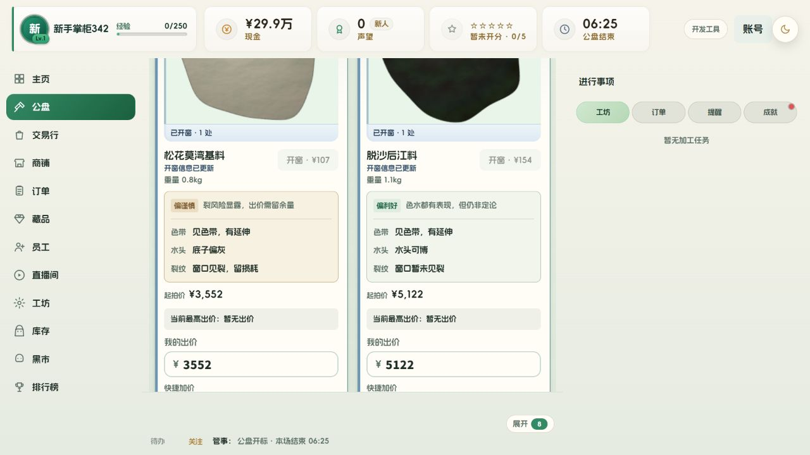

# 公盘开窗信息排版

按已确认的“判断前置”方案，将综合判断放在上方，用状态标签与建议正文展示；分隔线下方固定三行观察：色带、水头、裂纹。每行使用固定宽度的名称列和完整描述列，保持同行、不换行。

将两条较长的固定描述精简为“见色带，有延伸”“窗口见裂，留损耗”，保留“窗口暂未见裂”等不确定性。判断规则、开窗费用和竞拍逻辑保持原有行为。旧 `impact` 字段仍输出完整判断，新增的判断标签和建议字段仅供排版使用。

修改范围：`public/features/auction/auction-module.js`、`public/styles/feedback-modal.css`。

## 验证

- `node --check public/features/auction/auction-module.js` 通过。
- 现有 `styles-split-smoke`、`responsive-layout-smoke`、`jade-auction-smoke`、`experience-regressions-smoke`、`night-theme-smoke` 通过。未运行完整测试套件。
- 使用 game-playtest 在禁用持久化的独立 3018 测试服查看真实公盘卡片，覆盖中性、偏谨慎、偏利好及昼夜配色。三个观察区均为三行，名称与描述同行，完整显示，无横向溢出。
- 浏览器测量：实际卡片宽 306px；按实际固定内边距、标签列和 13px 字号保守计算，最长观察描述需要约 190px 卡片宽度，低于桌面卡片的 230px 最小宽度。未通过浏览器调整窗口尺寸测试移动端。
- 3000 常驻服务已通过 HTTP 返回最新前端模块与样式，刷新页面即可载入本次修改，无需重启服务。

