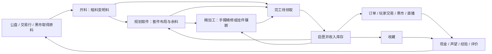

**翡翠街：项目架构评估与保持现有体验的重构方案**

评估日期：2026-10-23。对象是当前工作区代码，包含尚未提交的功能和改动。本文是分析与实施方案，本轮只新增本文档，没有实施业务代码重构。分析期间观察到其他开发改动继续写入工作区，包括黑市预览与性能检查文件；本文的统计和测试结果对应各自读取/执行时点，实际重构开始前应在稳定版本上重新建立基线。

审阅方式：扫描 `public/`、`server/`、`shared/` 的目录和相对导入依赖，重点审阅启动、通信、状态、工坊、交易、黑市、直播、工资、离线与存档链路，执行选取的现有检查，并查看已有界面截图。没有重新进行完整浏览器试玩、视觉截图回归、生产压测或真实 PostgreSQL 集成测试。已有截图只能作为参考，不能充当当前版本自动验收基线。

**1. 结论与适用范围**

项目可以继续支撑功能迭代，但目前更接近“完成第一轮代码拆分的单体”，距离边界稳定、容易独立维护的模块化单体还有差距。问题集中在模块内部职责混合、全局可变依赖、对完整世界状态的广泛访问，以及行为回归保障不够独立于实现。

没有一种目录结构是所有游戏通用的“行业最标准做法”。对这款多人经营游戏，应以服务端权威、业务内聚、状态写入可追踪、交易一致、协议稳定、能够隔离测试为评价依据。原生 DOM、Canvas/SVG、Node.js、Express、Socket.IO 这一组合与当前玩法相适应。

建议保留技术栈与单区单权威进程，在现有结构上完善“按玩法领域划分、领域内部按职责分层”的模块化单体。现有共享规则、事务提交屏障、存档和实时同步应继续作为基础。这个判断基于项目规模、共享经济系统和现有实现；[Monolith First](https://martinfowler.com/bliki/MonolithFirst.html) 对服务拆分成本与稳定边界的讨论也支持这种渐进路线，但它不是行业认证标准。

本方案的硬约束是：现有页面排版、文案、图片、主题、操作入口、点击顺序、拖拽行为、快捷键、弹窗行为、加工与经营规则均保持不变。已有问题若需要修复，应另立任务，避免和行为保持型重构混在同一批改动中。

**2. 当前玩法决定了应当如何拆分**

游戏核心是翡翠经营、资产流转、风险判断和时间调度。页面只是操作入口，模块边界还需要覆盖同一资产在多个玩法中的流转。



这不是强制玩家从头走到尾的线性关卡：原石、中间物和成品可以交易，玩家可以只经营其中一段；每道工序完工都经过待领取环节，领取后才能继续加工或出售。

| 玩法领域 | 当前行为 | 架构上需要明确的责任 |
| --- | --- | --- |
| 公盘 | 每场 10 分钟，前 8 分钟明拍、最后 2 分钟暗拍；入场、开窗、出价、托管、开标 | 轮次生命周期、现金冻结、公开信息与私有出价投影 |
| 工坊 | 开料、规划取件、精加工；多产物、余料；完工后启匣领取 | 工序规则、任务生命周期、设备和员工占用、材料预占、交付批次 |
| 原料与成品 | 玉料底稿、几何、取件轮廓、圈口、品质、镶嵌与来源继承 | 统一物品含义；规则和视觉表达分开；保留同料视觉继承 |
| 交易行 | 挂单、购买、撤单、领取货款、求购与应征 | 所有权转移、资金托管、税费、过期与退款 |
| 黑市 | 商品摊、盲盒、技术服务、NPC 货品与刷新、评价 | 按子玩法分开；与普通市场共用底层资金和库存能力 |
| 直播 | 公开房间、选货、主播、补货、玩家购买与自动成交 | 房间经营和资产结算由服务端负责；轮播与模拟聊天属于表现层 |
| 员工与设备 | 招聘、解雇、技能、跨工坊与直播占用、设备耐久和维修 | 统一员工占用查询与校验；工资和经营收入之间有明确结算顺序 |
| 工资与经营现金 | 北京时间自然日结薪、欠薪、24 小时宽限、收入补薪、停工与主动复工 | 独立工资状态机；保留正常收入、退款、保证金返还等资金来源的差异 |
| 成长 | 等级、经验、声望、成就、任务、订单质量、收藏和排名 | 统一成长规则；各业务通过明确 API 触发，避免重复发奖 |
| 离线与定时结算 | 断线期间加工和经营推进、重连补算、重启恢复 | 同一套结算规则可从在线 tick、离线补算和恢复流程调用 |
| 矿区 | 当前关闭入口和新操作；保留矿权、矿工、历史与既有任务结算 | 作为保留功能维护，关闭状态及存档兼容属于现有行为 |

需要冻结的近期规则包括：交易行与黑市开局开放；工坊三工序免加工费；镶嵌仍消耗库存材料；设备容量固定为 1；手镯有独立精修路径；完工即释放员工和设备，领取行为不重复生成产物。工资宽限是实际 24 小时，与 4 小时经营日分开。

玩法判断以当前代码和现有回归为依据。`docs/design-plan.md` 等早期文档含有旧阶段方案，例如加工费、原型存档状态等，不能直接作为本次重构的行为规范。

**3. 当前代码结构及已经具备的基础**

```text
server.js                         HTTP / Socket 服务入口
server/boot/wire-server.js        创建世界、服务、存档、tick 和通信依赖
server/shell/                    连接、指令、定时任务、广播和存档适配
server/services/                 玩法与经营服务
server/systems/                  员工、工资、设备、镶嵌、矿工规则与状态操作
server/world-store.js            内存世界与快照边界
server/persistence/              快照校验、迁移、变更跟踪、差量与查询投影
server/gateway/                  账号和管理 HTTP 入口
server/security/                 HTTP / Socket 安全与频率限制
server/observability/            日志、指标、健康检查

shared/domain/                   浏览器与服务端共享的玩法规则
shared/protocol/                 写事件与耐久事件清单

public/index.html                固定页面结构
public/main.js                   客户端启动、依赖注入和模块装配
public/shell/                    通信、导航、渲染调度、弹窗、主题、动作路由
public/features/                 按经营界面拆分的前端模块
public/*renderer.js 等           Canvas/SVG、成品、镶嵌与预览能力
public/*-module.js 等            很多是兼容旧导入路径的转导出文件
public/styles.css + styles/      样式入口与按顺序叠加的样式文件

scripts/                         冒烟、服务测试、Socket E2E、负载脚本和 fixture
.github/workflows/               发布门禁
```

当前关键链路是：客户端动作 → Socket 请求边界 → 安全和结构检查 → 耐久指令队列 → 指令处理器 → 玩法服务 → 内存世界变更 → 持久化提交 → 状态广播和反馈。重构必须保留“提交后才向玩家确认”的顺序。

有价值的基础如下：

- 服务端计算现金、库存、加工、时间和随机结果，浏览器负责提交意图与表现。
- 共享玩法规则已经迁到 `shared/domain/`，许多前端同名文件只是转导出，不是两份业务实现。
- `durable-mutation-coordinator.js` 已提供串行调度、提交屏障、回滚和网络效果延后；`atomic-mutation.js` 提供局部同步操作失败时的内存恢复。两者层次不同，不能当作重复代码直接删掉其中一层。
- 世界快照、增量日志和查询投影有明确恢复路径；支持 JSON、SQLite、PostgreSQL，正式环境按当前配置使用 PostgreSQL。
- 状态同步支持版本化顶层补丁，版本不连续时请求完整重同步；保留旧客户端完整状态路径。
- 已有动作路由、按页面分派的渲染管线、弹窗生命周期、虚拟列表、懒预览和位图缓存，可继续复用。
- 有大量玩法、服务、恢复与通信检查，以及 CI 发布门禁。

对 `public/`、`server/`、`shared/` 的静态相对导入扫描，本次未检出循环依赖。这是正面信号，但这种扫描不能发现通过回调、全局绑定或共享可变对象形成的运行时耦合。

**4. 代码规模与主要维护风险**

扫描时三个目录共约 259 个 JS 文件、6.7 万行，包含兼容转导出文件；不包含根目录入口、测试与第三方依赖。样式入口和分片共 18 个 CSS 文件，约 2.48 万行。工作区仍可能继续变动，以下行数用于识别热点，不作为设计合格线。

| 文件 | 审阅时行数约值 | 需要处理的职责问题 |
| --- | ---: | --- |
| `public/features/workshop/workshop-module.js` | 1,921 | 页面、选料选工、规划弹窗、精加工弹窗、预览测试器、请求、临时状态集中 |
| `public/features/livestream/livestream-module.js` | 1,836 | 大厅、经营、观看、补货、主播选择、聊天、轮播和多个弹窗集中 |
| `public/features/market/market-module.js` | 1,700 | 挂单、求购、筛选、虚拟列表、多个弹窗和提交逻辑集中 |
| `public/jade-renderer.js` | 1,504 | 多种玉料绘制、签名、画布调度等责任集中 |
| `server/boot/wire-server.js` | 1,040 | 服务依赖装配规模大，存在后绑定和运行时相互引用 |
| `server/shell/socket-handlers.js` | 1,022 | 大量依赖、连接处理、通用逻辑和部分玩法指令仍混合 |
| `server/services/mining-service.js` | 3,914 | 竞租、人员、经济、治理、恢复、健康与查询集中 |
| `public/mining-module.js` | 3,843 | 保留功能的界面、状态和交互仍未进入统一 feature 结构 |

重点不是把这些文件平均切成若干份，而是让每块代码的状态、依赖、输入输出和生命周期可以独立说明。

| 优先级 | 发现与证据 | 对后续迭代的影响 | 重构处理 |
| --- | --- | --- | --- |
| P1 | 工坊模块从第 50 行起持有依赖、选择状态和弹窗状态，后面同时包含绘制与开工逻辑；市场、直播同样使用模块级状态 | 改动一个流程容易影响其他弹窗和刷新；难以隔离创建、销毁与测试 | 使用 feature 工厂封装实例；分开状态、查询模型、控制器、视图和请求适配 |
| P1 | 公盘 `auction-service.js:25`、市场 `market-service.js:41`、黑市 `blackmarket/context.js:11` 使用 `let api` 和 `bind*Api` | 依赖绑定顺序隐含；同进程创建第二个世界会覆盖这些依赖；测试隔离困难 | 改为返回服务对象的工厂，旧导出暂由兼容层代理 |
| P1 | `WorldStore.raw` 暴露完整世界；多个服务通过 `getState()` 自由修改任意集合，工坊还有全世界访问 Proxy | 文件已拆分，写入权限仍很宽；跨领域资产变化难追踪 | 在现有存档形状之上增加按领域与事务参与者收敛的访问 API |
| P1 | `wire-server.js` 大规模装配，`createDeferredPlayerService()` 解决 normalize 与服务之间的后绑定 | 初始化顺序和领域相互调用相互牵制，新玩法经常要改总装配和大依赖包 | 区分玩家数据默认值、旧档迁移、领域标准化与用例编排，按稳定方向装配 |
| P1 | `refactor-contracts-smoke.mjs` 明确只冻结名称和字段提示；UI/响应式检查大量使用源码正则 | 代码搬动会使测试失效；源码匹配成功也不能证明布局和操作一致 | 补充可执行协议样本、浏览器行为和截图；现有检查逐步迁移，先保留覆盖 |
| P2 | `WORKSHOP_WORKER_FALLBACKS`、`WORKSHOP_DEVICE_FALLBACKS` 与服务端初始数据分开；例如阿成的部分技能默认值已有差异 | 异常/兼容路径可能展示不同默认值；规则改动容易漏同步 | 先刻画并冻结两个路径，再提取真实共享字段和显式兼容映射，不能直接覆盖一边 |
| P2 | `shared/domain/auction/jade-auction.js:321` 中构建弹窗事件并包含 CSS 类、按钮与 HTML 文案 | 核心规则与客户端表现协议混在一起 | 将结算规则、公开数据投影、现有弹窗 presenter 分开，保留原导出兼容 |
| P2 | 分析期间新增的 `public/features/blackmarket/previews.js:2` 从市场模块取得 `prepareMarketItemVisual` | 两个经营页面通过原本应共用的预览能力相连，公共渲染边界还没有独立 | 后续将物品预览与预热能力下沉到 `rendering`，保留当前优先级、缓存与有效性判断 |
| P2 | 91 个写事件、93 个耐久事件；只有部分事件有独立 payload schema，其余主要使用通用信封和公共字段检查 | 事件、字段、服务校验和前端调用需要跨文件对照 | 建立完整协议目录与样本，逐域描述当前合法载荷；保持既有兼容行为 |
| P2 | `player-service.js:113` 的 normalize 同时做补默认值、历史修复、跨桶移动、旧任务回收等 | 日常命令和读取容易夹带历史兼容动作；改变调用次数可能改变行为与成本 | 把一次性旧档迁移和持续规范化逐项分离；有版本和回归后再减少调用 |
| P2 | 大多数页面的渲染依赖仍归于顶层 `me` | 一处工资或库存变化可能触发当前整页的派生和更新 | 用纯 selector 与现有指纹减少无关更新，先不更改网络状态结构和 DOM 结构 |
| P2 | 质量门禁只对 9 个指定文件限行，对黑市子树检查循环导入 | 可以继续从其他路径引入跨层依赖；通过门禁不等于整体已解耦 | 增加全项目导入方向、跨领域私有访问、重复动作注册等规则 |

上述 P1/P2 表示本次重构的实施优先级，不代表已经确认的线上故障或安全漏洞。大文件、模块单例在当前单实例运行条件下并不自动构成 bug。

**5. 目标模块边界与状态归属**

目标是让新增玩法主要改动自己的领域，并通过少量明确接口接入现有经营系统。无需为每个小模块机械建立多层目录。

| 模块 | 拥有的规则和写入责任 | 允许向外提供的能力 |
| --- | --- | --- |
| jade | 物品种类、玉料几何、品质与来源继承等规则 | 规则计算与只读元数据；不拥有钱包或 DOM |
| inventory | 玩家物品的查询、占用检查、存取与转移 | 按物品 ID 获取、检查可用性、在明确位置间转移 |
| economy | 现金、冻结资金、收入来源和流水规则；与工资/纾困按既有顺序配合 | 支出、收入、冻结、释放、记录流水 |
| people | 员工、招聘、占用、工资状态机与复工；矿工继续独立在矿区子域 | 校验并占用/释放员工、发薪、补薪、复工、技能结算 |
| workshop | 工序开工与完工、设备状态、规划、预占材料、待领取批次 | 开工、结算到期、启匣、领取、设备维修等用例 |
| auction | 公盘轮次、出价、开窗、开标与托管规则 | 参与、投标、到期结算、针对玩家的公开信息 |
| market | 普通挂单和求购生命周期 | 上下架、购买、应征、取消、领取货款 |
| blackmarket | 商品、盲盒、委托服务、NPC 生成与评价各自的生命周期 | 各子玩法用例；通过库存/资金能力完成资产变化 |
| livestream | 房间与货盘、主播、成交、关播和结算 | 开播、补货、购买、到期结算、关闭 |
| orders / collection | 订单匹配与交付、收藏与取回 | 调用库存、资金、成长能力完成本领域用例 |
| progression | 等级、经验、声望、成就与任务的规则 | 明确的成长变更和奖励接口，避免业务自行重复发奖 |
| mining | 保留矿区的竞租、班次、经济、人员、治理和恢复 | 保持入口关闭；继续已有任务结算和数据恢复 |

跨领域资金和物品变化必须在当前同一个耐久事务里完成。例如“市场购买”由市场用例明确协调买家钱包、卖家待收款、物品所有权和挂单状态，不能让其中某一步依赖异步消息最终补齐。

客户端状态分为三类：服务端快照是经营状态的权威镜像；当前页签、筛选、选择、拖拽草稿属于 feature 实例；缓存、画布和计时器属于表现或生命周期资源。客户端不能自行把乐观展示写回权威资产状态。

服务端 WorldStore 保持唯一在线世界。领域“拥有状态”是指写入责任和访问 API 收敛，首轮不拆数据库、不改变存档字段、不把一份世界分成多个独立提交的状态容器。

**6. 推荐目录演进**

继续保留现有三个主目录。下面的新目录是迁移方向，不要求一次性移动所有文件。尤其 `public/styles/`、资源 URL 和静态服务路径在主体重构期间保持原样。

```text
public/
  main.js                         保留浏览器入口，只负责装配
  shell/
    client-state.js               接收完整快照/补丁，版本与订阅
    socket-client.js              现有 Socket 请求与会话适配
    feature-registry.js           注册 feature 及既有动作/渲染依赖
    navigation.js                 保留现有导航行为
    render-pipeline.js            保留调度语义，逐步接入 selector
    ...
  features/
    workshop/
      index.js                    唯一对外 API
      create-workshop-feature.js  创建实例、绑定、销毁
      state.js                    当前设备/员工/物料/弹窗草稿
      selectors.js                纯查询、可加工项与预览模型
      actions.js                  既有 data-action → 控制器
      view.js                     原页面模板与局部 patch
      picker-controller.js
      planner-controller.js
      finish-controller.js
      delivery-ui.js              沿用现有交付实现
      bangle-finish-ui.js          沿用现有手镯实现
    market/                       listings / wants / filters / dialogs
    livestream/                   hall / owner / viewer / host / chat
    blackmarket/                  保留子玩法，收敛 shared 全局状态
    auction/ inventory/ orders/ shop/ hire/ ...
  ui/                             原格式化、弹窗、预览组件等通用表现能力
  rendering/                      玉料、成品、镶嵌与预览缓存
  styles/                         文件、选择器、声明与加载顺序保持
  assets/                         保持现有资源路径

shared/
  domain/                         玩法规则与可共享元数据
  protocol/                       事件名、载荷/结果约定、兼容版本
  presentation/                   需要两端复用的既有结算弹窗构建器

server/
  boot/
    wire-server.js                保留总装配入口
    create-game.js                可隔离创建的游戏实例
    compose-services.js           按稳定方向组合领域工厂
  application/
    command-registry.js           事件 → 用例及现有策略
    durable-command-runner.js     由当前 coordinator 演进，保留提交语义
  modules/
    workshop/                     service / planning / roster / delivery
    auction/                      service / lifecycle / escrow / projections
    market/                       listings / wants / settlement
    blackmarket/                  goods / blind / commission / npc / rating
    livestream/ people/ inventory/ economy/ progression/ mining/ ...
  gateway/
    socket/                       连接、领域事件适配、原有反馈兼容
    account-routes.js
    admin-routes.js
  persistence/                    继续复用当前快照、差量、投影与迁移
  infrastructure/                 最后再归拢具体存档驱动和时钟等适配
  world-store.js                  内存世界边界不变
  security/ observability/        保留并按职责调用
```

服务端 `modules/` 的目录移动要放在服务工厂和访问边界稳定之后。先在现有路径内拆职责，再借助转导出迁移，避免同时修改路径、依赖、运行语义和测试。

依赖规则应由自动检查约束：

1. `shared/domain` 只能依赖共享规则；不访问 DOM、Socket、数据库和服务端模块。规则尽量显式接收时间和随机输入；现有默认行为保持。
2. 客户端 feature 只能通过其他 feature 的 `index.js` 调用公开 API，不引用其临时状态或内部控制器。通用渲染和 UI 不反向依赖某个玩法页面。
3. 服务端领域服务不直接向 Socket 发包；渐进改为返回领域结果与待发送效果，由现有适配边界在提交后发送。过渡期间保留 coordinator 对当前发包方式的保护。
4. 网关负责会话、校验、协议映射和现有反馈，用例负责业务编排，持久化负责提交和恢复；数据库表结构不成为领域间通信协议。
5. 模块只暴露实际需要的 API；兼容转导出单独登记，禁止新业务继续增加旧路径引用。
6. 跨领域的重要业务调用保持显式、同步且在同一事务中。提交后的事件可用于通知和视图更新，不能承担扣款、转移物品或发奖的必要步骤。

**7. 工坊试点的具体拆分方式**

工坊覆盖了游戏最多的核心依赖，已有模型、控制器和交付模块可以复用，适合作为第一批样板。首先只做前端职责拆分，再处理对应服务端工厂和生命周期；不在一个变更中横跨全部层。

| 当前内容 | 目标落点 | 需要保持的行为 |
| --- | --- | --- |
| 模块级设备、物料、员工和弹窗变量 | `create-workshop-feature` 的实例闭包 / `state` | 切换页签、开关弹窗和草稿提交/取消规则一致 |
| `workshopDevices`、`workshopWorkers`、可加工项和预计时间 | `selectors` 与共享规则适配 | 当前回退值、排序、时长舍入与说明文案一致 |
| 工序页签、设备列表、配方页 HTML | `view` | 原 HTML、class、id、data 属性、节点层级和顺序一致 |
| 选料/选工与排序搜索 | `picker-controller` | 搜索、键盘、焦点、滚动和临时选择一致 |
| `workshopOpenPlanner`、刷新、关闭规划 | `planner-controller` | 现有 pointer 捕获、拖拽坐标、旋转、缩放、提交/放弃与余料洞一致 |
| 精加工弹窗和字段 patch | `finish-controller`，复用现有 model/controller/dom 文件 | 手镯/挂件分支、材料校验、预览、滚动、焦点和 ack 后关闭行为一致 |
| 镶嵌预览测试器 | 单独预览测试器控制器 | 保持目前入口可用性与行为，不顺带隐藏或移除 |
| 完工启匣与领取 | 沿用 `delivery-ui` | 完工释放占用；展示既有真实产物；多件及余料一次转移；重连恢复进度 |
| 开工、分配员工等网络调用 | `actions` / 窄请求适配 | 事件名、字段、requestId、等待/禁用、反馈次数和顺序一致 |

每个 feature 的生命周期建议统一为 `mount / render / dispose`，也可以增加进入/离开钩子。`dispose` 释放本实例的动作注册、监听、订阅、观察器和计时器。当前 `action-router` 只有注册/派发，应增加可注销能力并保留旧调用兼容；不能用整页重建来代替清理。

新增“再次创建两个独立实例”“页面往返后不会重复提交”“弹窗关闭后焦点返回原按钮”等行为检查。这些测试验证真实边界，不依赖拆分后的私有函数名称。

**8. 服务端重构必须保护的状态与事务边界**

先把 `bindAuctionApi / bindMarketApi / bindBlackmarketApi` 改造为 `createAuctionService / createMarketService / createBlackmarketService`。每个工厂接收自己的窄依赖，返回对外方法。过渡兼容层继续支持现有导入与测试，内部新代码只使用实例对象。

`create-game` 可以注入 WorldStore、存档适配器、时钟、随机源和 ID 生成器，以便独立测试。注入随机源时默认仍调用原有实现，并保持随机调用次数、顺序和范围；不能在此过程中改掉掉落分布或把生产随机算法换成另一套。

WorldStore 的升级采用包裹现有结构的方式，例如玩家读取/可写取得、挂单查询、物品转移和钱包操作。开始时仍写入原来的 `rough / materials / slices / bracelets` 等字段；`bracelets` 这个历史字段实际承载多类成品，第一轮不重命名。

特别注意：`mutation-scope.js` 当前通过玩家 Map 的读取登记事务参与者。新封装必须在写入前调用已有可写取得路径，把买卖双方纳入回滚范围；不能缓存队列外玩家对象，也不能把只读 `peek` 返回对象直接修改。回滚会替换部分对象，保留旧引用可能绕过恢复。

现有的在线 tick、离线补算、恢复和管理操作都需要走现有提交队列。拆出领域定时任务时，只移动任务处理和注册代码，保留调用先后、频率、去重和到期边界。新建多个进程或并行领域写队列不属于本轮目标。

对库存建立完整位置清单：直接库存、加工任务输入、待领取批次、收藏、普通挂单、求购应征托管、黑市货盘/盲盒/委托、直播货盘。它们不能因为读取位置不同而被当成互不相关的物品。先用访问和转移 API 统一语义，暂不更换保存格式。

工资结算与收入到账的先后不能调整。`earnCash` 当前会先处理到期工资，再记收入，再按来源和上限处理纾困与工资偿还；退款/保证金释放是不同路径。过度抽象成一个通用“加钱”函数会改变玩法。

Socket.IO 默认的交付保障不能代替应用的幂等与恢复机制；[官方交付说明](https://socket.io/docs/v4/delivery-guarantees/)明确区分消息有序和默认至多一次到达。保留 requestId、去重历史范围、耐久确认、断线补同步和重复请求的现有返回语义。本轮不新增自动重试策略，也不把当前重复请求的失败反馈改成缓存成功结果。

**9. 哪些是冗余，哪些是必须保留的不同职责**

| 类别 | 建议 |
| --- | --- |
| 前后端各自维护同一业务公式和相同元数据 | 收敛到一份规则/目录，由客户端预览和服务端裁决共同调用 |
| 初始员工/设备与 UI fallback 存在差异 | 先识别差异和到达条件；用明确兼容配置保持行为，再决定如何合并 |
| `public/*-module.js`、旧 `public/blackmarket/*` 和部分根文件转导出 | 是过渡兼容入口，业务逻辑通常只有一份；登记消费者，迁完再删 |
| 相似的市场和黑市商品卡 | 优先共用元数据、格式化、图像和明确相同的小组件；保留各自费用、反馈与交互差异 |
| 历史事件只返回旧路径提示，旧存档含历史字段 | 归入兼容适配，保留已冻结行为；没有使用证据不能直接删除 |
| 矿区关闭但仍有实现和定时结算 | 属于保留功能；关闭入口、拒绝新操作与结算存量任务都要继续测试 |
| 业务校验、网络校验、存档校验 | 是不同信任边界，不能因为字段相似而合成一个“万能 schema” |
| 原始世界、数据库查询投影、传输视图、客户端渲染缓存 | 是不同用途的数据表达；明确唯一权威和重建方式，比机械消除副本更重要 |
| CSS 重复选择器和覆盖规则 | 可能依赖级联产生当前效果。主体重构先保持文件与顺序，单独治理时逐页比较计算样式和截图 |

“无冗余”应指同一业务决策只有一个维护源、无消费者的兼容入口最终移除。不能为减少行数而消除合理的边界或把不同玩法合成高度可配置的巨型通用模块。

**10. 不改变 UI 与玩法的验收设计**

“不改样式文件”还不够：节点顺序、额外容器、文本空白、焦点、滚动、刷新时机、画布缓存键和 pointer 事件都可能改变体验。应同时固定视觉、交互、协议、状态和存档。

| 基线 | 具体内容与判定 |
| --- | --- |
| UI 静态结构 | 原模板提取时保持 HTML 内容；固定 class/id/data 属性、节点层级、DOM 顺序、资源 URL 和 CSS 导入顺序；不加额外包裹元素 |
| 视觉 | 固定 fixture、时钟、随机输入、浏览器版本、系统、字体和 DPR；覆盖现有页面及关键弹窗、日夜主题、桌面与移动端；对比截图和关键元素边界 |
| 交互 | 点击路径、回退、筛选、排序、键盘、触屏、规划拖拽、选工、弹窗焦点/滚动、未提交草稿、按钮等待状态与提示顺序一致 |
| 网络 | 每个事件记录当前合法 payload、ack、toast、ui:event、状态变化及兼容路径；保留 `state / state:patch` 版本与完整重同步行为 |
| 业务 | 相同初始世界、时间、ID 和随机输入，旧实现与新实现得到相同现金、流水、库存、托管、占用、任务、成长和交付状态 |
| 存档 | 当前和代表性旧版本存档加载后结果相同；工坊待领取、工资宽限、黑市托管、暗拍信息和关闭矿区状态完整；保存后重启恢复一致 |
| 资源 | 页间切换与弹窗反复开关后，监听、timer、observer 与订阅不会重复；缓存命中与失效规则保持 |

浏览器视觉检查可以使用 Playwright 的 `toHaveScreenshot()`；[官方文档](https://playwright.dev/docs/test-snapshots)同时提醒基线和验证必须处于一致的渲染环境。仓库当前没有把该工具作为项目开发依赖，需要在第 0 阶段正式建立可复现的配置，而不是假设已有截图等于 CI 视觉门禁。

主视口建议先采用项目已有的 1280×720、1440×900、390×844、430×932；对已有的 320 窄屏和 1920 宽屏案例补充代表性检查。先覆盖全部现有可见页面与高风险弹窗，再按改动领域运行细化用例，避免不必要地扩张测试组合。矿区验收其入口关闭与保留结算，不人为打开页面作为正常可见功能。

截图比较中冻结倒计时和动态聊天等输入；确实不能稳定的非业务区域才能使用有记录的屏蔽。不能屏蔽价格、按钮、产品预览和布局来获得通过。不得自动覆盖基线接受差异。

业务差分要比较结果和副作用顺序，而不只是“最终现金相同”。固定输入并记录随机调用序列；对必要生成的 ID 用保持引用关系的映射比较，不能忽略所有 ID 和时间字段，从而漏掉重复物品或时点变化。

必须保留的代表性流程：

1. 公盘入场、开窗、修改出价、明转暗、开标、退款与领取后的库存导航。
2. 开料 → 启匣领取 → 摆套件规划/取消/提交 → 多产物与余料领取 → 手镯精修/挂件镶嵌 → 订单交付。
3. 设备/员工已被占用、材料不足、工资宽限到期、欠薪补齐但尚未主动复工时，现有禁止/允许行为一致。
4. 普通市场购买与求购、黑市商品/盲盒/技术委托、直播补货/购买/关播，失败不会部分扣款或重复转移物品。
5. 同一请求重复提交、断线重连、状态补丁断裂、持久化失败回滚、完成未领取时重启，结果与反馈一致。
6. 员工自然日结薪、实际 24 小时宽限、20% 经营收入补薪及与纾困合计 30% 上限、停工和主动复工一致。
7. 关闭矿区的全部入口和新操作仍关闭，既有任务继续结算，存档保持可恢复。

**11. 分阶段实施与回滚**

现有工作区已有大量业务改动。实施前先记录认可的当前工作树快照，保留未提交代码，使用单独重构分支；不重置或覆盖用户已有改动。基线应来自此时认可的版本，不能直接拿较旧的 Git HEAD 或历史截图代替。

| 阶段 | 工作范围 | 完成条件 | 回滚范围 |
| --- | --- | --- | --- |
| 0：固定基线 | 整理当前玩法契约、存档 fixture、事件样本、视觉/交互基线；记录模块消费者和依赖 | 当前代码先通过同一套基线；测试能在隔离端口与临时存档上运行 | 仅测试和文档，业务未改 |
| 1：工坊前端试点 | 先拆 selectors 与原模板，再拆 picker/planner/finish，最后实例化状态与生命周期 | 原有 UI、草稿、拖拽、开工、启匣和领取完全一致；迁移中旧导出可用 | 每个小批次可单独还原；不改变协议或存档 |
| 2：服务实例与写入边界 | 公盘/市场/黑市工厂化；创建可隔离游戏实例；窄化钱包、库存和员工 API；拆玩家初始化与迁移责任 | 同进程两个独立世界互不影响；跨玩家资产操作仍在原事务；回滚和重启检查通过 | 保留旧服务 API 兼容壳，逐域回滚 |
| 3：其他前端领域 | 市场的挂单/求购/弹窗，直播的大厅/经营/观看/聊天，黑市的状态和控制器；归拢通用渲染 | 每迁一个领域通过对应视觉、行为、Socket 和状态契约；不顺带改 CSS | 以单个领域为回滚单位 |
| 4：网关与运行调度 | 指令按领域注册、窄依赖注入；装配/定时处理分离；将表现构建器移出核心规则 | 事件与反馈顺序、提交屏障、在线/离线时间语义均一致 | 旧注册/导出桥接维持到调用方完成迁移 |
| 5：清理与门禁 | 迁完消费者后删除兼容入口；整理测试分类；为保留矿区单独分域；补依赖和类型门禁 | 无新增旧路径依赖，无跨模块私有访问，无未归属状态；运行完整既有发布门禁 | 独立清理提交；存档格式始终保持兼容 |

每阶段拆成小变更，优先区分“搬文件/改导入”和“改变内部依赖方式”。不要求每阶段只有一个巨大 PR。工坊、服务端实例化、市场、直播和清理都应能够独立审阅与还原。

阶段 2 与阶段 3 可按实际开发安排交替进行，但同一批变更不要同时更改一个玩法的前端状态、协议和服务端状态模型。保留原方法签名和兼容壳，使每次替换可验证。

整体属于多轮迭代，不适合一次性全仓库重写。排期应在阶段 0 和工坊试点后根据实际依赖调整；本次没有给出缺乏团队人数、测试设备和发布频率依据的工期承诺。

每个批次在合并前检查：改动领域的现有测试、新基线中的相关场景、依赖方向；阶段发布再执行完整 `npm test`、`test:server-release`，涉及生产存储的阶段执行真实 PostgreSQL 发布检查。失败先还原该批次，不通过更新截图或放宽断言掩盖行为变化。

**12. 工程门禁与最终交付条件**

在保留 native ESM 的基础上，先对公共 API、事件载荷、快照和新拆模块补 JSDoc 与渐进类型检查。可使用 TypeScript 的 `allowJs / checkJs / noEmit` 检查 JavaScript；[checkJs 官方说明](https://www.typescriptlang.org/tsconfig/checkJs.html)确认此路径无需先把源码全量改为 TypeScript。具体工具版本在实施时锁定。

新增导入方向检查应覆盖全部代码，不只黑市。新增代码禁止跨领域读取内部状态、绕过钱包/库存 API 写资产、在事务外保存可变玩家引用；兼容路径列入有退出条件的白名单。禁止重复注册动作时静默覆盖，提供开发期可诊断错误。文件行数预算作为提醒，最终仍按职责判断。

将测试组织为规则、服务、协议、浏览器行为、视觉、持久化恢复、容量与运维几组。路径可以渐进整理，现有 `npm run` 命令先保留兼容；源码字符串断言只承担确有必要的静态边界检查，业务行为逐步转成输入输出断言。迁移测试不能简单删除旧断言而丢失它曾覆盖的场景。

重构最终应交付以下可检查结果：

- 每个玩法有唯一公开入口、明确状态归属与依赖清单，新功能主要修改所属领域。
- 共享业务规则和目录只有一个维护源，兼容差异有明确定义，旧入口有消费者登记与移除条件。
- 服务可隔离创建；客户端 feature 可创建、挂载、退出和销毁；关键测试不再必须从 `server.js.__testHooks` 取得整个应用。
- 资金、物品、员工占用、任务和发奖的写入入口可追踪，所有耐久变更保留现有队列及提交保障。
- UI、交互、协议、数值和存档行为与基线一致，有截图、操作断言和状态差分作为证据。
- 当前部署、会话、安全、观测、完整状态/补丁兼容、JSON/SQLite/PostgreSQL 支持及关闭矿区策略继续通过原有门禁。

继续增加 Node 游戏进程副本不能直接带来同一世界的正确水平扩容。当前世界常驻单进程内存，拆模块后仍是单权威世界。若后续容量确有需要，应单独依据队列等待、tick 耗时、事件循环、内存、广播与数据库指标决定分区/分服和并发控制方案；本次没有重新测量容量，也不作并发人数承诺。

**13. 本轮验证记录与证据入口**

在 Node v24.19.0 下，选取的现有 23 个脚本全部通过。服务相关检查使用 `JADE_WORLD_PERSIST=0` 避免对当前游戏存档写入；部分脚本自行构造隔离内存或临时 fixture。没有执行全量 `npm test`、真实 Socket E2E、负载测试或 PostgreSQL 集成测试。

```text
architecture-quality-gate
refactor-contracts-smoke
shared-domain-smoke
gameplay-rules-smoke
feature-availability-smoke
planning-authority-smoke
atomic-mutation-smoke
durable-mutation-coordinator-smoke
state-patch-smoke
socket-event-schema-smoke
workshop-service-smoke
workshop-delivery-smoke
employee-payroll-policy-smoke
market-service-smoke
blackmarket-service-smoke
livestream-service-smoke
offline-service-smoke
world-store-smoke
finish-plan-controller-smoke
modal-lifecycle-smoke
ui-stability-smoke
responsive-layout-smoke
styles-split-smoke
```

通过结果说明当前选取的规则、服务、提交边界及静态契约在本轮执行中成立，不能推导为已经完成视觉或全部交互等价验证。`refactor-contracts-smoke` 当前冻结 71 个事件名称与 14 个视图标记，写事件清单则有 91 个事件，两者目的与覆盖范围不同。

关键源码位置：`public/features/workshop/workshop-module.js:50`、`public/features/market/market-module.js:25`、`public/features/livestream/livestream-module.js:53`、`server/boot/wire-server.js:212`、`server/services/auction-service.js:25`、`server/services/market-service.js:41`、`server/services/blackmarket/context.js:11`、`server/world-store.js:55`、`server/persistence/mutation-scope.js:5`、`server/services/durable-mutation-coordinator.js:17`、`server/services/player-service.js:113`、`server/protocol/socket-event-schemas.js:65`、`public/styles.css:1`、`scripts/architecture-quality-gate.mjs:6`、`scripts/refactor-contracts-smoke.mjs:1`。

建议的第一批实际工作是阶段 0 的行为与视觉基线，再进行工坊前端职责拆分；完成这两步后，用经过验证的模块样板推进其余领域。
